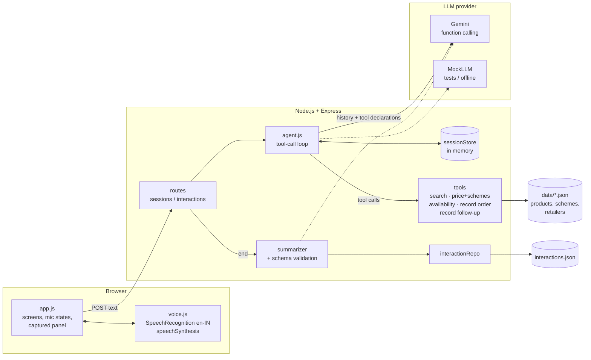

# Sunfield Retailer Connect: AI voice agent for FMCG retailer engagement

A working prototype of an AI sales rep ("Asha") that **calls a kirana store**, answers questions on products, prices, schemes and stock, captures order enquiries and follow-ups, then **summarises and saves** the interaction.

Brands, prices (₹) and retailers are fictional.

- **Voice in the browser**: Web Speech API recognition and synthesis (`en-IN`), with a text box that always works.
- **Grounded answers**: Gemini function calling over five tools. The model never states a price, stock level or scheme that a tool didn't return.
- **Structured summary**: validated JSON saved with the full transcript. History screen to review past calls.
- **Runs without an API key**: a deterministic MockLLM drives the same tools, for tests and offline demos.

## Quick start

1. Install Node.js 20+, then run `npm install`.
2. Copy `.env.example` to `.env` (`copy .env.example .env` on Windows) and set `GEMINI_API_KEY` (free key at https://aistudio.google.com/apikey). *Optional:* without a key the app uses the offline MockLLM.
3. Run `npm start`.
4. Open **http://localhost:3000** in **Chrome or Edge** and allow the microphone when asked.
5. Run `npm test` to run the test suite (no key or network needed).

## Environment variables

| Variable | Default | Purpose |
|---|---|---|
| `GEMINI_API_KEY` | *(empty)* | Gemini API key. Read only on the server. If empty, MockLLM is used. |
| `GEMINI_MODEL` | `gemini-3.5-flash` | Any Gemini model with function calling, e.g. `gemini-flash-latest`. |
| `LLM_PROVIDER` | *(empty)* | Set to `mock` to force MockLLM even when a key is set. |
| `PORT` | `3000` | HTTP port. |
| `INTERACTIONS_FILE` | `data/interactions.json` | Where saved interactions go. |

## Run and test

```bash
npm start                      # http://localhost:3000
npm run dev                    # same, restarts on file changes
npm run start:mock             # offline MockLLM, no key needed (same as LLM_PROVIDER=mock)
npm test                       # node:test: tools, summary schema, end-to-end conversation
```

The tests cover:
- `tests/tools.test.js`: search, price/schemes (active vs expired), stock levels and alternatives, order and follow-up validation.
- `tests/summary.test.js`: summary schema validation, LLM plus captured-facts merge, fallbacks, and the repository.
- `tests/conversation.test.js`: an end-to-end conversation over HTTP with MockLLM. It covers price, expired scheme, out-of-stock, order with confirmation, follow-up, off-topic, then end, summary, save and history. It also covers input validation and an LLM-failure retry with rollback.

## Project structure

```
server/
  index.js              start-up: picks the LLM, starts Express
  app.js                createApp({ llm, repo }): wiring (tests inject mocks)
  config.js             env vars, IST "today"
  errors.js             HttpError, input validation, error middleware
  routes/               meta.js (health, retailers) · sessions.js (start/message/end) · interactions.js (history)
  services/
    agent.js            the tool-call loop, turn rollback, end-of-call save
    prompts.js          system prompt, greeting, summary prompt
    summarizer.js       LLM narrative + captured facts, rule-based fallback
    summarySchema.js    summary JSON Schema and validator
    sessionStore.js     in-memory sessions with idle expiry
    text.js             strip markdown/emojis from replies
  llm/                  index.js (provider choice) · gemini.js (@google/genai) · mock.js (MockLLM)
  tools/                catalog.js (search/price/stock) · capture.js (order/follow-up) · index.js (declarations + dispatcher)
  store/                interactionRepo.js (JSON file behind list/get/save)
public/                 index.html · styles.css · app.js (UI) · api.js (fetch) · voice.js (Web Speech)
data/                   products.json (15 SKUs) · schemes.json (6, one expired) · retailers.json (4)
tests/                  node:test suites
docs/                   DEMO_SCRIPT.md · INTERVIEW_NOTES.md
```

## Architecture



**One turn:** browser sends text → agent appends it to history → LLM returns tool calls → agent runs them and sends the results back (at most 5 rounds) → LLM returns a short reply → server strips markdown → browser shows it, speaks it, and updates the "Captured so far" panel.

### API

| Method & path | Body | Returns |
|---|---|---|
| `GET /api/health` | | `{ ok, llm, model }` |
| `GET /api/retailers` | | retailer list |
| `POST /api/sessions` | `{ retailerId }` | `{ sessionId, retailer, reply, captured }` (greeting) |
| `POST /api/sessions/:id/messages` | `{ text }` (≤ 500 chars) | `{ reply, captured, toolsUsed }`; on LLM failure `503 { error, retryable: true }` |
| `POST /api/sessions/:id/end` | | `{ interaction }`: summary, transcript, captured, timestamps, duration |
| `GET /api/interactions` | | history rows (newest first) |
| `GET /api/interactions/:id` | | full interaction |

### Summary shape (example)

```json
{
  "overview": "Sanjay ji asked about SilkLeaf 340 ml (out of stock) and ordered the 180 ml instead...",
  "outcome": "order_enquiry",
  "products": [{ "sku": "SHP-SLK-180", "name": "SilkLeaf Shampoo 180 ml", "quantity": 5, "unit": "cases" }],
  "schemes_discussed": [{ "id": "SCH-SILK-3PCT", "name": "SilkLeaf 3 percent off", "status": "active" }],
  "followups": [{ "type": "callback", "details": "Call back about the BrightWash offer", "when": "Saturday morning" }],
  "sentiment": "positive",
  "next_action": "Confirm the SilkLeaf order and call back on Saturday morning.",
  "generated_by": "llm"
}
```
`outcome` is one of `order_enquiry | follow_up_required | info_only | not_interested`. Products, schemes and follow-ups come from captured tool data, not from model text.

## Manual Chrome checklist for voice

Use Chrome or Edge on **http://localhost:3000**. Voice needs localhost or HTTPS.

- [ ] **First start**: click a retailer, then **Start conversation**. The greeting is spoken aloud, using the name, in an Indian English voice if the OS has one. This click is the user gesture that unlocks speech.
- [ ] **Permission prompt**: on the first mic tap Chrome asks for the microphone. Allow it. The mic turns red and pulses ("Listening...").
- [ ] **Interim transcript**: words appear in grey italics while you speak, then your message bubble appears.
- [ ] **States**: idle (orange) → listening (red) → thinking (amber, button disabled) → speaking (green) → idle.
- [ ] **Silence**: tap the mic and say nothing. Recognition stops after a few seconds and returns to idle without an error.
- [ ] **Tap to stop**: while listening, tap again. Whatever you said so far is sent.
- [ ] **Interrupt**: while the agent is speaking, tap the mic. Speech stops right away and listening starts.
- [ ] **Hands-free**: tick **Hands-free**. After each reply the mic reopens by itself. It never listens while the agent speaks (no echo loop). After two silent listens it pauses with "Hands-free paused, tap to resume".
- [ ] **Typing takes over**: type while listening or speaking. Listening and speech stop, and the typed text is sent.
- [ ] **Numbers and ₹**: ask a price. "₹121" is spoken as "121 rupees", and "12.75" isn't split into two sentences.
- [ ] **Long reply**: replies are spoken sentence by sentence, so Chrome's ~15-second cut-off doesn't truncate them.
- [ ] **Denied mic**: block the microphone (padlock icon → Microphone → Block) and reload. Start a call: a yellow banner explains it, the mic shows "Voice unavailable", and typing works.
- [ ] **Unsupported browser**: open in Firefox. A banner says speech recognition isn't supported. Typing works, and replies are still spoken if synthesis is available.
- [ ] **Non-secure origin**: open via your LAN IP (e.g. `http://192.168.x.x:3000`). The banner explains that voice needs localhost or HTTPS.
- [ ] **Errors**: stop your network (or use an exhausted key) and send a message. A friendly error with **Retry** appears, and Retry resends without duplicating anything.
- [ ] **End & summarize**: the summary card shows, and the call appears under **History** with the full transcript.

## Assumptions

- The "call" is simulated in the browser: the person at the keyboard plays the retailer. There's no telephony.
- One sales company (Sunfield Consumer Products), one agent persona (Asha), English (`en-IN`).
- Captured orders are **order enquiries**. The sales team confirms pricing, schemes and dispatch, so the agent doesn't promise delivery.
- Prices are per unit (pack). Orders are in `cases` or `units`, and the case size comes from the product data.
- "Today" for scheme validity is the current date in IST. Active schemes in the sample data run until early 2027. The end-to-end test uses the real date, so update `data/schemes.json` dates after that.
- "Schemes discussed" means schemes returned by `get_price_and_schemes` during the call.
- A single server instance. Sessions live in memory and expire after 30 minutes idle.

## Limitations

- **Free-tier quotas are tiny**: during development the key was limited to **5 requests/minute and 20 requests/day** on `gemini-3.5-flash`. A turn takes 1–3 requests plus 1 for the summary, so one free-tier day covers only about one demo call. Quotas are per model, so switching `GEMINI_MODEL` gives a fresh quota. For a real demo, use a paid key or `npm run start:mock`. A rate-limited turn shows a friendly **Retry**, and a rate-limited summary falls back to the rule-based one (`generated_by: "rules"`).
- **Latency**: about 2–8 s per turn depending on tool steps. There's no streaming.
- **Browser speech**: best in Chrome/Edge. Chrome's recognition uses Google's servers, so it needs internet. Voice quality depends on the OS voices. There's no true voice barge-in (tap to interrupt instead).
- **MockLLM is keyword-based**: it's fine for tests and demos, but only understands simple phrasings.
- Scheme maths isn't applied to order totals (the estimate uses the retailer price only). There's no auth, no per-user rate limiting, and JSON-file storage is single-process.

## Future improvements

- Streaming STT/TTS (or a realtime speech model) with real barge-in. Telephony integration (Twilio, Exotel) for actual outbound calls.
- Stream replies into TTS for lower perceived latency.
- Apply schemes to compute order totals. Push order enquiries to CRM/ERP and schedule follow-ups in a calendar.
- Hindi/Hinglish and regional languages per retailer.
- An LLM eval suite (tool-call correctness, numbers match tool output, reply length), tracked per prompt or model version.
- Redis sessions, a database for interactions, auth, rate limiting, PII handling and an analytics dashboard.

More detail: [docs/DEMO_SCRIPT.md](docs/DEMO_SCRIPT.md) · [docs/INTERVIEW_NOTES.md](docs/INTERVIEW_NOTES.md)
